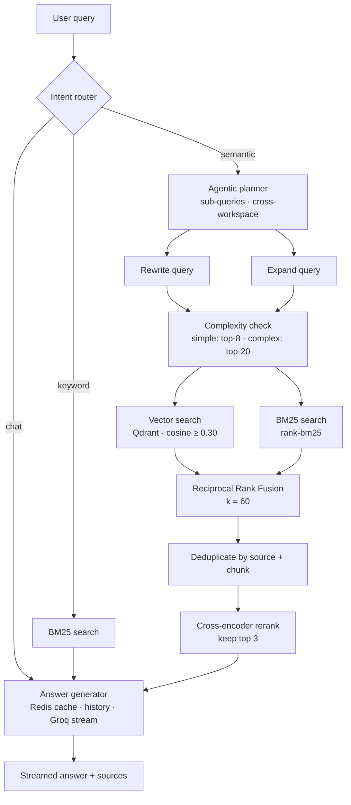

<div align="center">

# 🔎 NeuralSearch — Agentic AI Search Engine

**Hybrid retrieval (vector + BM25) · Reciprocal Rank Fusion · Cross-encoder reranking · Streaming LLM answers**

Ask questions about your own documents and get grounded answers, with the sources they came from.


-F55036)

</div>

---

## Table of Contents

- [Overview](#overview)
- [Features](#features)
- [How It Works](#how-it-works)
- [Tech Stack](#tech-stack)
- [Quick Start](#quick-start)
- [Configuration](#configuration)
- [Using the App](#using-the-app)
- [API Reference](#api-reference)
- [Evaluation](#evaluation)
- [Testing](#testing)
- [Project Structure](#project-structure)
- [Design Decisions](#design-decisions)
- [Roadmap](#roadmap)

---

## Overview

NeuralSearch is a full-stack **Retrieval-Augmented Generation (RAG)** system. You upload documents (`.txt`, `.pdf`, `.docx`) into isolated **workspaces**, then either:

- **Search** — get the top 3 most relevant passages, ranked by a multi-stage hybrid pipeline, or
- **Ask AI** — get a natural-language answer streamed token by token from Llama 3.3 70B, grounded in retrieved passages, with source attribution and multi-turn memory.

It ships with two demo workspaces (`got` — Game of Thrones, `dexter` — Dexter) and a 20-question ground-truth set for measuring retrieval and answer quality.

---

## Features

| | |
|---|---|
| 🧬 **Hybrid search** | Dense vectors (`all-MiniLM-L6-v2`) + sparse BM25, fused with Reciprocal Rank Fusion |
| 🎯 **Cross-encoder reranking** | `ms-marco-MiniLM-L-6-v2` rescores candidates and keeps the best 3 |
| 🤖 **Agentic retrieval** | Splits compound questions into sub-queries; routes comparison questions across workspaces |
| 🧭 **Intent routing** | Small talk skips retrieval, entity lookups use BM25 only, everything else gets the full pipeline |
| ✍️ **Query rewriting & expansion** | Two LLM calls run in parallel to sharpen the query and add synonyms |
| ⚡ **Streaming answers** | Token-by-token responses from Groq, with a graceful fallback to raw passages if the LLM fails |
| 💬 **Conversation memory** | Per-session history (last 6 turns) stored in SQLite and fed back to the LLM |
| 🗂️ **Dynamic workspaces** | Create/delete workspaces at runtime; each one is its own Qdrant collection |
| 🚀 **Redis caching** | Answers cached for 1 hour; repeated questions return instantly |
| 📊 **Observability** | Latency and cache-hit metrics, plus every query logged to SQLite |
| 🔐 **Security** | API-key auth on all mutating/retrieval endpoints, per-IP rate limiting on `/ask`, CORS |

---

## How It Works



| Stage | Module | What it does |
|---|---|---|
| Intent routing | `router.py` | Classifies the query as `chat`, `keyword` or `semantic` |
| Planning | `query_planner.py`, `agentic_retrieval.py` | Splits on "and", adds "reason for" variants to *why* questions, detects cross-workspace comparisons |
| Rewrite + expand | `query_rewriter.py`, `query_expander.py` | Run concurrently in a `ThreadPoolExecutor` (~1200 ms → ~600 ms) |
| Complexity | `query_complexity.py` | Rule-based; picks retrieval depth and rerank-candidate count |
| Embed | `embedding.py` | 384-dim sentence embeddings |
| Retrieve | `vector_db.py`, `keyword_search.py` | Dense + sparse retrieval within the workspace |
| Fuse | `rank_fusion.py` | RRF so passages found by both methods rise to the top |
| Rerank | `reranker.py` | Joint (query, passage) scoring for precise ordering |
| Generate | `answer_generator.py` | Cached, history-aware, streaming generation with source attribution |

**Ingestion:** uploaded files are text-extracted, split into 3-sentence windows with 1-sentence overlap, embedded, stored in Qdrant with metadata, and the BM25 index is rebuilt.

---

## Tech Stack

| Layer | Technology |
|---|---|
| API | FastAPI, Uvicorn, Pydantic, SlowAPI |
| Vector store | Qdrant (embedded file mode by default, or server mode) |
| Keyword search | rank-bm25 (BM25Okapi) |
| Models | sentence-transformers: `all-MiniLM-L6-v2`, `cross-encoder/ms-marco-MiniLM-L-6-v2` |
| LLM | Llama 3.3 70B Versatile via the Groq API |
| Cache | Redis |
| Persistence | SQLite (workspaces, document sources, conversations, query logs) |
| Frontend | React 18, TypeScript, Vite, Tailwind CSS, shadcn/ui |
| Tooling | Docker Compose, pytest, Vitest, Playwright |

---

## Quick Start

### Prerequisites

- **Python 3.11+**
- **Node.js 18+**
- **Docker** (for Redis), or a local Redis server
- A free **Groq API key** from [console.groq.com](https://console.groq.com)

### 1. Clone

```bash
git clone https://github.com/Harsh181507/ai-search-engine.git
cd ai-search-engine
```

### 2. Backend

```bash
python -m venv venv
venv\Scripts\activate            # Windows
# source venv/bin/activate       # macOS / Linux

pip install -r requirements.txt
```

> The first run downloads the embedding and reranker models (~100 MB) from Hugging Face.

### 3. Environment

Copy the templates and fill in your keys (see [Configuration](#configuration)):

```bash
cp .env.example .env                    # set GROQ_API_KEY and API_KEY
cp frontend/.env.example frontend/.env  # set VITE_API_KEY to the same API_KEY
```

> No secrets live in the source — the backend, frontend, tests and scripts all read the key from these files.

### 4. Redis

```bash
docker compose up -d redis
```

### 5. Run the backend

```bash
uvicorn backend.main:app --host 0.0.0.0 --port 8000
```

Interactive API docs: **http://localhost:8000/docs**

### 6. Run the frontend

```bash
cd frontend
npm install
npm run dev
```

Open **http://localhost:8080** 🎉

---

## Configuration

### Backend — `.env` (project root)

| Variable | Required | Default | Description |
|---|:---:|---|---|
| `GROQ_API_KEY` | ✅ | — | Groq key used for rewriting, expansion and answer generation |
| `API_KEY` | ✅ | — | Secret clients must send in the `X-API-Key` header |
| `REDIS_HOST` | | `localhost` | Redis host (port 6379) |
| `FRONTEND_ORIGIN` | | `http://localhost:8080` | Allowed CORS origin |
| `QDRANT_MODE` | | `file` | `file` = embedded storage on disk, `server` = connect to a Qdrant server |
| `QDRANT_FILE_PATH` | | `data/qdrant` | Storage path in `file` mode |
| `QDRANT_HOST` / `QDRANT_PORT` | | `localhost` / `6333` | Server address in `server` mode |

### Frontend — `frontend/.env`

| Variable | Description |
|---|---|
| `VITE_API_KEY` | Must match the backend `API_KEY` |

---

## Using the App

The UI has five tabs:

1. **Search** — enter a query, pick a workspace, and see the top passages with their rerank scores and sources.
2. **Ask AI** — chat with your documents. Answers stream in live and follow-up questions keep context.
3. **Upload** — add `.txt`, `.pdf` or `.docx` files to a workspace; they're chunked and indexed immediately.
4. **Workspaces** — create or delete workspaces (`default`, `got` and `dexter` are protected).
5. **Metrics** — total queries, average latency and cache hit rate.

---

## API Reference

Send `X-API-Key: <API_KEY>` on every endpoint marked 🔐.

| Method | Endpoint | Auth | Description |
|---|---|:---:|---|
| `GET` | `/health` | | Health check |
| `GET` | `/metrics` | | Query count, average latency, cache hit rate |
| `GET` | `/logs` | 🔐 | 20 most recent query logs |
| `GET` | `/workspaces` | | List workspaces |
| `POST` | `/workspaces` | 🔐 | Create a workspace — body `{"name": "my-docs", "description": "..."}` |
| `DELETE` | `/workspaces/{name}` | 🔐 | Delete a workspace and its vectors |
| `POST` | `/search` | 🔐 | Hybrid search — body `{"query": "...", "workspace": "got", "source": null}` |
| `GET` | `/ask` | 🔐 | Streamed answer — params `query`, `workspace`, `conversation_id` (30 req/min per IP) |
| `POST` | `/upload` | 🔐 | Upload and index a file — param `workspace`, multipart field `file` |

Workspace names: lowercase letters, digits and hyphens, 1–50 characters, starting and ending with a letter or digit.

<details>
<summary><b>Examples</b></summary>

```bash
# Search
curl -X POST http://localhost:8000/search \
  -H "X-API-Key: $API_KEY" -H "Content-Type: application/json" \
  -d '{"query": "Who killed Ned Stark?", "workspace": "got"}'

# Ask (streamed)
curl -N "http://localhost:8000/ask?query=Why%20did%20Dexter%20kill&workspace=dexter&conversation_id=demo" \
  -H "X-API-Key: $API_KEY"

# Upload
curl -X POST "http://localhost:8000/upload?workspace=default" \
  -H "X-API-Key: $API_KEY" -F "file=@notes.pdf"
```

`POST /search` response:

```json
{
  "query": "Who killed Ned Stark?",
  "workspace": "got",
  "results": [
    {
      "text": "Ned Stark was executed on the orders of King Joffrey...",
      "source": "got.txt",
      "chunk_id": 3,
      "rerank_score": 0.9847
    }
  ]
}
```

</details>

---

## Evaluation

`data/evaluation.json` holds 20 ground-truth questions (10 Game of Thrones, 10 Dexter).

**Retrieval quality** — Recall@k, MRR, per-query-type breakdown and latency:

```bash
python scripts/evaluate_retrieval.py --workspace got
python scripts/evaluate_retrieval.py --workspace dexter --top_k 5
```

**Answer quality** — hit rate, faithfulness and average length (the backend must be running):

```bash
python scripts/evaluate_answers.py --workspace got
python scripts/evaluate_answers.py --workspace dexter --base_url http://localhost:8000
```

Results are written to `data/eval_results_<workspace>.json` and `data/answer_eval_<workspace>.json`.

---

## Testing

```bash
# Backend API tests (health, auth, search shape, workspace isolation, logs)
pytest tests/ -v

# Frontend unit tests
cd frontend && npm test
```

---

## Project Structure

```
ai-search-engine/
├── backend/
│   ├── main.py                    # FastAPI app: routes, auth, rate limiting, CORS, startup
│   └── services/
│       ├── search.py              # Retrieval orchestrator
│       ├── agentic_retrieval.py   # Sub-query + multi-workspace execution
│       ├── query_planner.py       # Single vs comparison routing
│       ├── query_rewriter.py      # LLM query rewriting
│       ├── query_expander.py      # LLM query expansion
│       ├── query_complexity.py    # Simple/complex classifier
│       ├── router.py              # chat / keyword / semantic intent
│       ├── embedding.py           # Sentence embeddings
│       ├── vector_db.py           # Qdrant collections + search
│       ├── keyword_search.py      # BM25 index + search
│       ├── rank_fusion.py         # Reciprocal Rank Fusion
│       ├── reranker.py            # Cross-encoder reranking
│       ├── answer_generator.py    # Streaming Groq generation + fallback
│       ├── cache.py               # Redis cache
│       ├── conversation.py        # Multi-turn history
│       ├── document_processor.py  # Extract → chunk → embed → index
│       ├── chunking.py            # Sentence-window chunking
│       ├── logger.py              # SQLite persistence
│       └── metrics.py             # In-memory counters
├── frontend/                      # React + TypeScript + Vite UI
│   └── src/pages/Index.tsx        # Search · Ask AI · Upload · Workspaces · Metrics
├── scripts/                       # Indexing and evaluation utilities
├── tests/test_api.py              # pytest API tests
├── data/                          # Demo corpora + evaluation set
├── docker-compose.yml             # Redis + Qdrant services
├── Dockerfile                     # Backend image (Python 3.11)
└── requirements.txt
```

---

## Design Decisions

- **Hybrid over vector-only.** Embeddings capture meaning but miss exact names; BM25 catches them. RRF combines both without tuning weights.
- **Rerank last.** Bi-encoders are fast but approximate; the cross-encoder is precise but slow, so it only sees a small candidate set.
- **Parallel LLM preprocessing.** Rewriting and expansion are I/O-bound, so threads halve the wait without an async rewrite.
- **Route before retrieving.** Greetings don't need a vector search, and known entity names do better with BM25 alone.
- **SQLite for state.** Workspaces, sources, history and logs survive restarts without running another database.
- **Fail soft.** If Groq is down, users still get the retrieved passages instead of an error.

---

## Roadmap

- [ ] Run the backend as a service in `docker-compose.yml`
- [ ] Move the frontend API base URL into an environment variable
- [ ] Token-aware chunking and PDF table extraction
- [ ] Per-user API keys and auth on the frontend

---

<div align="center">

Built by **[Harsh181507](https://github.com/Harsh181507)** — if this project helped you, consider giving it a ⭐

</div>
